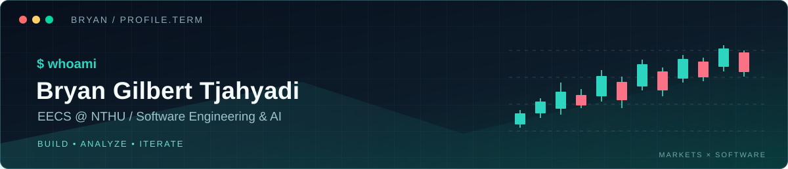
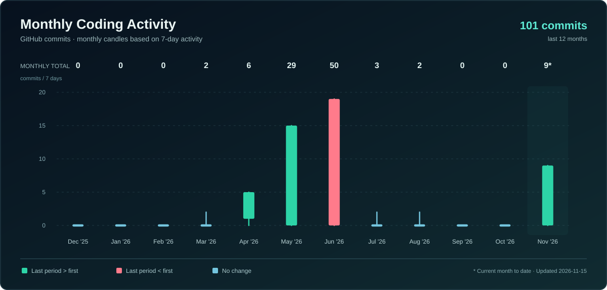

<!-- Profile for https://github.com/BryanGilbert-T -->

  
    
  <strong>Computer Science student at NTHU, building software and exploring financial markets.</strong>
    
  <a href="https://www.linkedin.com/in/bryan-gilbert-hl/">LinkedIn</a> &nbsp;·&nbsp;
  <a href="https://github.com/BryanGilbert-T?tab=repositories">My repositories</a>

## A little about me

I'm **Bryan**, an Electrical Engineering and Computer Science undergraduate at **National Tsing Hua University** in Taiwan. I enjoy making software, exploring how things work, and learning to make better decisions with data.

- **Currently:** Teaching Assistant for Introduction to Programming (Python)
- **Interested in:** Software engineering, artificial intelligence, data, and financial markets
- **Outside coding:** Stocks and crypto, poker, golf, books, and 2010s pop

## Languages & tools

**Programming:** Python · C · C++ · Java · SQL · Dart

**Tools & platforms:** Flutter · Firebase · Git · CMake · pandas · NumPy · scikit-learn · Selenium

  

## Featured projects

| Project | What it does |
| --- | --- |
| **[Goal Digger](https://github.com/anotherfei/Goal-Digger-App)** | Team-built productivity application using Flutter, Firebase, and AI-assisted planning. |
| **[Sun-Wu-Kuo](https://github.com/BryanGilbert-T/Sun-Wu-Kuo)** | A 2D C++ action RPG demonstrating object-oriented design and modular game systems. |
| **[God of Tsinghua](https://github.com/BryanGilbert-T/God-of-Tsinghua)** | A 2D game written in C with Allegro 5 and real-time gameplay systems. |
| **[Bitcoin Price Predictor](https://github.com/BryanGilbert-T/Bitcoin-Price-Predictor)** | A Python machine-learning project exploring cryptocurrency price prediction. |

Also worked on a **Python analytics pipeline for a telecom competition**, automating data cleaning, support-note processing, and audience generation.

## Monthly coding activity

A market-inspired visualization of my **GitHub commit contributions** over the last 12 months, automatically updated through GitHub Actions.

- **Horizontal axis:** Months; **vertical axis:** commits per seven-day period.
- **Green / red candles:** More / fewer commits in the last period of the month than the first.
- **Candle high / low:** Most / fewest commits in any seven-day period within that month.
- **Number above each candle:** Total commits counted for that month. **\*** denotes the current, incomplete month.

*Counts follow GitHub's contribution rules, so they may exclude commits on non-default branches and private repository activity. The chart reflects coding activity, not financial prices.*

## Beyond the screen

I like studying **equities, crypto, and macroeconomics**, and spending time with **poker, golf, books, and 2010s pop**.

Curiosity compounds.

